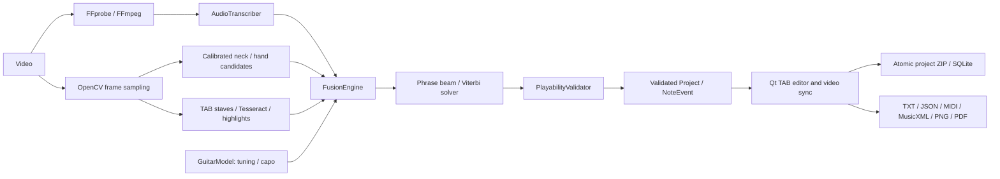

# Architecture and implementation boundaries

A local Windows desktop workstation. The Phase 1–4 vertical path works independently
of optional CV/OCR models. Analyzer outputs are evidence, not ground truth.

## Contracts

`core.events` defines notes, techniques, chords, rhythm, confidence and evidence.
Times are seconds in the original media timeline. Pitch is integer MIDI; string 1
is the highest string. `GuitarModel.open_strings` is ordered low to high. TAB fret
numbers are relative to capo; CV calibration fret indices are relative to the nut.

`audio.transcription.AudioTranscriber` separates analyzers from storage/UI.
Basic Pitch uses its packaged ONNX model on CPU; 30-second overlapping chunks bound
memory and cancellation latency. The spectral backend is a genuine STFT peak tracker
with harmonic rejection and re-attacks, suited to exposed melodies/simple riffs.
Neither backend claims accurate transcription of arbitrary distorted/backing-track audio.

`video.analyzer.HandTracker` is replaceable. Heuristic neck detection only proposes
regions and cannot establish a nut or physical fret index. Manual four-corner
calibration supplies geometry; physical fret spacing and string-line detection
convert optional MediaPipe tips to low-confidence contact candidates. Uncalibrated
regions never claim a precise string/fret. Moving cameras need recalibration.

`ocr.tab_ocr.OCRBackend` separates digit recognition from stave geometry. Tesseract
returns complete digit groups, including 10–24. Colored highlight transitions give
candidate timing. Static/scrolling digits without confirmed timing remain observations
and cannot create onsets. Highlight colors are heuristic evidence, not proof.

`fusion.FusionEngine` combines compatible observations with audio onsets, resolves
weak audio versus stronger evidence and flags persistent conflicts. Other chord
tones are not conflicts. Finger visibility alone never creates a sounding note.
Absent CV yields Audio + FingeringSolver rather than stopping analysis.

`guitar.fingering_solver` runs bounded beam/Viterbi search across the phrase. States
carry the previous position and sustained-string occupancy. Costs cover string/hand
movement, chord stretch and position. Open strings do not force a hand jump to the
nut. Search pruning is approximate; scores are not calibrated probabilities.
Every unassignable note is kept with alternatives and an uncertainty flag.

`workers.pipeline` is UI-independent and runs through QThread. Mutating controls
are disabled while running; playback and cancellation remain responsive. Failed
or cancelled runs never replace the editor project. FFmpeg cancels immediately;
ML cancels between chunks. Audio cache identity includes full media SHA256, backend,
algorithm version and interval. Frames stream rather than loading entire video.

`storage.project_storage` atomically writes a versioned ZIP with validated JSON,
relative media paths where possible, and a decompressed-size limit. Projects do
not contain video. Loading does not extract archive paths. Missing media can be
relinked; reopening cached notes never requires analysis. SQLite holds recent
projects/preferences. Manual edits and deleted automatic onsets survive reanalysis.
Undo/redo includes the records suppressing deleted/moved automatic onsets.

## Implemented and future capabilities

Implemented: import/player/extraction/waveform; spectrum and Basic Pitch transcription;
tuning/capo/custom 6–8 strings; candidate/phrase optimization; onset chord grouping;
conservative tempo estimate; time-scaled editable TAB; uncertainty review;
selection reanalysis; loop/speed/frame stepping; copy/paste/undo/redo; save/load/relink;
six export formats; TAB-stave digit OCR and highlights; calibrated CV/optional MediaPipe;
configuration/logging; Windows packaging and CI definitions.

Techniques can be manually edited/persisted. Automatic bend/slide/vibrato/palm-mute
recognition, learned neck detection, reliable moving-neck tracking, right-hand
analysis, barre/finger inference, chord naming/strum direction, riff reconciliation,
adaptive sampling, beat-accurate engraving, OCR technique symbols/ASCII tabs,
source separation and Guitar Pro export are later modules. No placeholder controls
claim these capabilities. MusicXML uses independent string voices and seconds-based
timing; it does not invent measures/time signatures. MIDI preserves pitch/timing/
velocity but not guitar techniques. PNG is one long page; PDF is paginated.

## Evidence required for production accuracy

Controlled tests cover mathematical mapping, phrase evidence/string occupancy,
source conflicts/chords, manual preservation, storage/corruption, actual spectral
and optional Basic Pitch inference, FFmpeg/cache/intervals, real Tesseract grouping/
highlight transitions, Qt editing/undo/redo/background analysis, media playback and
exports. Synthetic fixtures establish path correctness, not accuracy on arbitrary
guitar performances. Evaluate against diverse annotated videos and calibrate
confidence before making note/fingering precision and recall claims.
